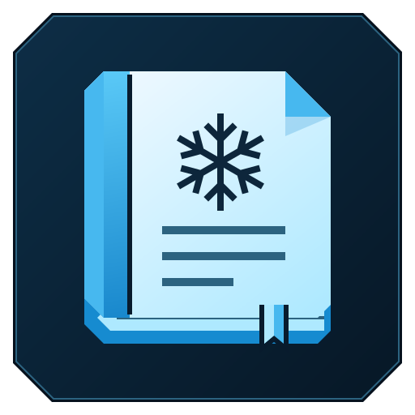
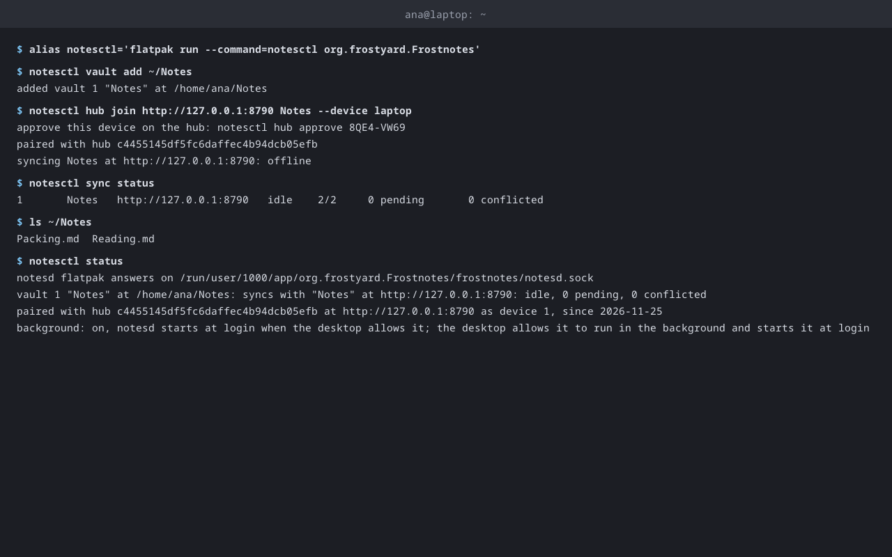

<!-- readme-kind: app -->


# Frostnotes

[](https://github.com/frostyard/frostnotes/actions/workflows/ci.yml)

**Plain markdown notes on your own computer.**

Frostnotes is for people who keep notes as plain markdown files, in the
spirit of Obsidian. The notes stay in a folder you own, and you edit them
with any editor of Markdown files, Obsidian among them. A daemon, notesd,
indexes the folder, syncs it through a hub you host, and serves the notes
to a web app and to agents. On a desktop it has no window: the Flatpak
runs notesd in the background, and you set it up with `notesctl`.

**Status:** pre-release. The [roadmap](docs/plans/0002-roadmap.md) says what works and what comes next.

**Documentation:** [frostyard.org/docs/apps/frostnotes](https://frostyard.org/docs/apps/frostnotes/)



## What it does

- **Your files are the notes.** A note is a `.md` file with YAML
  frontmatter. notesd writes it byte for byte and keeps its own state out
  of the vault. [ADR-0003](docs/adr/0003-plain-markdown-files-are-the-source-of-truth.md)
- **notesd owns your vaults.** It watches the files, keeps a SQLite index
  (full text, links, backlinks, tags, properties), and never writes over
  an edit it has not seen. [Vault design](docs/design/vault.md)
- **Every write is a version.** Each write, an agent's included, is kept
  for 30 days: `notesctl versions PATH` lists them and `notesctl revert`
  undoes one. [Versions](docs/design/vault.md#versions)
- **Sync is built in.** Each device syncs with a self-hosted hub, the same
  notesd in a hub role, which keeps every revision and merges concurrent
  edits. No conflict copies. [Sync design](docs/design/sync.md)
- **Any editor on the desktop.** Obsidian, or any other editor of
  Markdown files, edits the vault folder; notesd sees its writes and syncs
  them. The Flatpak holds notesd and `notesctl` and no window, starts
  notesd at login, and `notesctl` registers folders, pairs the computer
  with a hub and shows sync. [The Flatpak](docs/design/app.md#the-flatpak)
- **The web app** is a React UI with a CodeMirror 6 editor, served by
  [lodge](https://github.com/frostyard/lodge), frostyard's tailnet-only
  web shell, with Obsidian's phone layout on a narrow screen.
  [notesd as a lodge app](docs/specs/lodge-app.md)
- **Agents** search, read and write notes through MCP: `notesctl mcp`
  locally, or lodge's `/mcp/notes` with a scoped token. [MCP tools](docs/specs/mcp.md)
- **Obsidian vaults open as they are:** wikilinks, embeds, tags, callouts
  and properties. [Markdown dialect](docs/specs/markdown.md)

## Install

Frostnotes is on the [Frostyard Flatpak remote](https://github.com/frostyard/flatpak-index),
with notesd and `notesctl` inside. Add the remote and Flathub (for the
runtime) once, for your user, then install Frostnotes and update it with
`flatpak update`:

```sh
flatpak remote-add --user --if-not-exists frostyard https://frostyard.github.io/flatpak-index/frostyard.flatpakrepo
flatpak remote-add --user --if-not-exists flathub https://dl.flathub.org/repo/flathub.flatpakrepo
flatpak install --user frostyard org.frostyard.Frostnotes
```

Then start notesd, which also asks the desktop to start it at each login,
and set up a vault from a terminal:

```sh
flatpak run org.frostyard.Frostnotes      # start notesd, and show its status
alias notesctl='flatpak run --command=notesctl org.frostyard.Frostnotes'
notesctl vault add ~/Notes                # the folder your editor opens
notesctl hub join URL Notes               # pair with the hub and sync its vault "Notes"
notesctl status                           # notesd, the vaults and their sync
```

`hub join` prints a code to approve on the hub (`notesctl hub approve
CODE` there). `notesctl status` also says why
notesd is not running, from the end of its log. `notesctl background off`
stops the desktop from starting notesd at login, and `notesctl background
on` turns that back on. An install from a release with a window keeps its
vaults, its pairing and its background setting when it updates.

Other ways: each [release](https://github.com/frostyard/frostnotes/releases)
has `frostyard-notesd`'s .deb, which runs notesd and notesctl as lodge's
notes app ([notesd as a lodge app](docs/specs/lodge-app.md)), and
[docs/development.md](docs/development.md) builds everything from source.

## Remove

```sh
flatpak uninstall --user org.frostyard.Frostnotes
```

Your vaults stay: they are your folders. notesd's index, versions and
sync state stay in `~/.var/app/org.frostyard.Frostnotes/` unless you add
`--delete-data`. A device's sync token stays in the Secret Service, in an
item labeled `Frostnotes: …`. Without a Secret Service, the Flatpak keeps
no token and cannot pair, unless you run `flatpak override --user
--env=FROSTNOTES_SECRETS=file org.frostyard.Frostnotes`; the token is then
in a 0600 file in that data directory
([ADR-0045](docs/adr/0045-the-flatpak-keeps-no-device-token-in-a-plain-file.md)).

## Problem records

notesd writes its panics, and a few of its coded errors (a database that does not migrate, a write that does not reach the
disk, a failed merge, a lost watch event, a sync protocol fault), to the
local systemd journal. They send nothing over a network. A record holds the
app ID (`org.frostyard.Frostnotes`), its release version, the runtime (Go
or Rust), the part (`daemon` or `gui`), the class (`panic` or `error`), the
error's code or the panic's frames or place in the source, and a message
that can name a note's path and stays on your machine. A development build
records nothing. Only chairlift can send a record off the machine, and only
with your consent
([ADR-0036](docs/adr/0036-notesd-and-the-app-record-problems-in-the-journal.md)).
To see them:

```sh
journalctl MESSAGE_ID=8915bdd215c84cbab0c31c05a1a33e7e
```

## Develop

```sh
mise install        # host: golangci-lint, svu and nfpm, pinned
make check          # host: generated files, vet, lint, unit tests
nsl create frostnotes --distro debian:13
nsl run -m frostnotes --root bash dev/nsl/provision.sh "$(id -un)"
make ci             # make verify, the race gate and the app checks (nsl)
```

[docs/development.md](docs/development.md) covers the requirements,
running notesd from source, and the app's dev loops. The architecture
starts at [docs/design/overview.md](docs/design/overview.md).

## Where to go next

- [AGENTS.md](AGENTS.md): the rules for agents and contributors.
- [docs/README.md](docs/README.md): the decisions, designs, specs and plans.
- [SECURITY.md](SECURITY.md): report a vulnerability privately.
- [LICENSE](LICENSE): MIT.
